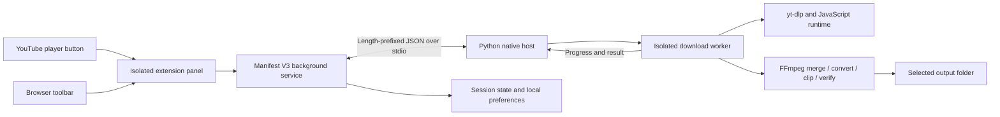

# YouTube Downloader Extension

A Chromium browser extension for downloading YouTube videos, audio, playlists,
and precise clips through a local Python/FFmpeg engine. Created by
[DanielCulpian](https://github.com/DanielCulpian). Licensed under [MIT](LICENSE).

**Supported operating system: desktop Windows 10/11.** The extension targets
current Chromium-based browsers that support Manifest V3 and Native Messaging:
Chrome, Edge, Brave, Vivaldi, Chromium, and Opera/Opera GX. Other compatible forks
can use a configurable native-host registration prefix. Browsers that disable
these APIs cannot run the project unchanged. See [compatibility](docs/COMPATIBILITY.md)
for the distinction between implemented support and verified browser installations.

## Features

- MP4 video with audio, or high-quality VBR MP3 audio.
- Download button next to the YouTube player's settings control, plus a toolbar panel.
- Precise clips using manually entered timestamps or the current playback position.
- Complete playlists grouped in a folder named after the playlist, with ordered filenames.
- Windows Downloads as the default destination, including redirected folders.
- Progress, speed, remaining time, logs, and cancellation of the worker and FFmpeg together.
- Translucent green completion glow on the source tab's download button. A playlist
  triggers one notification after the entire list succeeds, never between files.
- Closing the panel by clicking outside it; scrolling and dragging keep it open.
- One visible scrolling region and a fixed panel header.

The existing interface remains in Spanish. Source function summaries, installation
instructions, and repository documentation are in English.

## Requirements

- Windows 10/11 and a current desktop Chromium-based browser.
- **Python 3.11+**, available as `python`, with Tkinter installed.
- **Node.js 22+ or Deno 2.3+** on PATH for YouTube's JavaScript challenges.
- Internet access and enough disk space for output and temporary source files.

The standard Windows Python installer includes Tkinter. The installer creates
an isolated environment and installs `yt-dlp[default]` and `imageio-ffmpeg`, which
provides FFmpeg on supported Windows architectures. No API key, project account,
local HTTP server, or open network port is required.

## Installation

1. Download this repository as a ZIP and extract it, or clone it with Git.
   Keep the entire project in a permanent directory.
2. Double-click **`install.bat` at the repository root**. Wait for dependency setup
   and native-host registration to finish. Administrator access and system-wide
   PATH changes are not required.
3. Open your browser's extension manager:

   | Browser | Address |
   | --- | --- |
   | Chrome / Chromium | `chrome://extensions` |
   | Edge | `edge://extensions` |
   | Brave | `brave://extensions` |
   | Vivaldi | `vivaldi://extensions` |
   | Opera / Opera GX | `opera://extensions` |

4. Enable **Developer mode**, click **Load unpacked**, and select
   **`extension-vivaldi/extension`**, the folder containing `manifest.json`.
5. Allow YouTube site access and reload the YouTube page. Optionally pin the
   extension to the toolbar.

The `extension-vivaldi` directory name is retained to preserve existing installation
paths. Its implementation is shared by all supported Chromium browsers.

For terminal installation, run:

```powershell
powershell.exe -NoProfile -ExecutionPolicy Bypass -File .\extension-vivaldi\install.ps1
```

This execution-policy option applies only to the installer process; it does not
change persistent machine settings. Installation is needed once: later browser
sessions start the native engine when the panel connects.

For a fork with a vendor-specific native-host location, supply its documented
registry prefix without `Software` or `NativeMessagingHosts`:

```powershell
.\extension-vivaldi\install.ps1 -AdditionalBrowserRegistryPaths 'Vendor\Browser'
```

`Vendor\Browser` is a placeholder. See [browser registration details](docs/COMPATIBILITY.md).

## Usage

1. Open a YouTube video and click the download arrow next to player settings,
   or open the extension from the browser toolbar.
2. Select **MP4** or **MP3**.
3. Select **Playlist completa** for a whole playlist, or **Descargar solo un
   fragmento** for an individual video's time range.
4. Enter clip boundaries as seconds, `MM:SS`, or `HH:MM:SS`, or use **Marcar aqui**
   at each playback position. Ads cannot be used as markers.
5. Select a destination and click **Descargar**.

Individual files go directly into the chosen folder. Playlist files go into
`<destination>/<playlist name>/`, with position and video ID in each filename.
Characters prohibited by Windows are sanitized. There are no MP3/MP4 subfolders.
Custom destinations and draft clip boundaries are remembered.

One request runs at a time per browser profile; it may contain an entire playlist. Opening the panel
or starting another request clears the completion glow. Reduced-motion preferences
replace the animation with a static glow. Failed/canceled requests never trigger it.

### Clip processing and limitations

Clips download the **complete source streams** to a temporary directory, merge
them, and cut locally. MP4 clips use H.264/AAC; MP3 clips use VBR MP3. FFmpeg then
decodes the result to verify that audio and video cover the requested duration.
Truncated audio is reported instead of padded with artificial silence.

This costs more transfer, time, and temporary space than downloading a remote
section. Clipping and MP3 conversion are lossy. Source quality depends on YouTube.
Existing clips are preserved by choosing a numbered filename such as `clip (2).mp4`.

Closing the panel does not stop a download. Closing the browser, disabling the
extension, or reloading it disconnects the engine and cancels the job. Temporary
source files are cleaned; a forced interruption can leave a `.ytdl-*` output
fragment or partial download that can be removed manually.

Unavailable playlist entries are skipped and reported, and the job is marked
incomplete. Private/authenticated videos, cookie import, live-stream clipping,
DRM circumvention, mobile browsers, Linux, and macOS are outside current support.

## Architecture



The player script injects a button and an extension-origin iframe. The background
service owns the native connection and job state. The Python bridge validates
commands, runs an isolated worker, and forwards events. A Windows job object
groups the worker and FFmpeg descendants for cancellation. Completion is reported
after the whole request, including all playlist entries, has finished.

See [the architecture reference](docs/ARCHITECTURE.md) for protocol, permissions,
state lifecycle, temporary files, and component responsibilities.

```text
README.md, LICENSE, DISCLAIMER.md
install.bat, uninstall.bat
docs/                           Architecture, compatibility, release checks
extension-vivaldi/
  extension/                    Manifest, player integration, panel, service
  backend/                      Native bridge, worker, clipping, OS helpers
  tests/                        Python integration and JavaScript regressions
  browsers.json                 Native-host registration prefixes
  install.ps1, uninstall.ps1     Current-user setup and ownership-checked removal
  installer_support.ps1          Shared installer helpers
  requirements.txt
  .venv/, .runtime/              Generated locally; never commit
```

## Updates and uninstalling

- Reload the extension and YouTube after code updates. Do not update during a download.
- Run `install.bat` again to update dependencies or register additional browsers.
- If moving the project, recreate `.venv`, run the installer, and reload the unpacked
  extension from its new path. Python virtual environments are not portable.
- For a clean uninstall, first remove the extension in your browser manager so its
  native engine exits, then run **`uninstall.bat`**. It removes registry keys still
  owned by this installation and deletes the generated `.venv`, `.runtime`, and
  source/test caches. Source code, downloaded media, and any separate console app
  are preserved. A future run of `install.bat` recreates the generated environment.

The manifest's public key fixes the extension ID to
`folnohikggmdphdpningknpkkbmnimpo`. The historical host name `com.ytdl.vivaldi` is
retained for existing installations and works across the supported browsers.

To preview uninstallation without modifying anything:

```powershell
powershell.exe -NoProfile -ExecutionPolicy Bypass -File .\extension-vivaldi\uninstall.ps1 -CleanGenerated -DryRun
```

For the GitHub clean-install test, uninstall as above, upload only the source
files, download a fresh copy into its permanent location, run `install.bat`, and
load the freshly downloaded extension directory. Do not copy `.venv` or `.runtime`
from an existing installation.

## Privacy and permissions

`activeTab` and `scripting` read the chosen video's URL, title, and playback time.
YouTube host access inserts the player UI. `nativeMessaging` connects to the local
engine. `storage` remembers preferences, bounded logs, job state, and completion.

The project has no analytics or project-operated cloud service. yt-dlp contacts
YouTube/media endpoints; dependency installation contacts package repositories.
Preferences and logs can include video URLs and local paths. Remove personal
data before sharing diagnostics. The manifest public key is not a private signing key.

## Development and verification

After installation, run these commands from the repository root:

```powershell
.\extension-vivaldi\.venv\Scripts\python.exe -m unittest discover -s extension-vivaldi\tests -v
node --test extension-vivaldi/tests/background.test.cjs extension-vivaldi/tests/popup.test.cjs extension-vivaldi/tests/player.test.cjs
```

To inspect installer output without registry writes or dependency installation:

```powershell
.\extension-vivaldi\install.ps1 -PrepareOnly -SkipDependencies
```

Tests cover native framing, installer generation, playlist paths, scoped completion,
panel interactions, cancellation, and real FFmpeg clips. They do not prove operation
in every browser or against the current YouTube service. Follow the manual matrix
in [compatibility](docs/COMPATIBILITY.md) and the [release checklist](docs/RELEASING.md)
before publishing. No repository is published automatically.

## License and responsible use

Project-owned code uses the [MIT License](LICENSE), copyright 2026 DanielCulpian.
Read the [Responsible Use and Liability Disclaimer](DISCLAIMER.md). Download only
content you are legally entitled and authorized to access and copy. The software
license grants no rights to third-party media and no permission to ignore platform
terms. The author does not endorse malicious use or infringement.

Dependencies retain their own licenses; this repository's MIT license does not
relicense yt-dlp, FFmpeg, their dependencies, or downloaded media. See
[third-party notices](docs/THIRD_PARTY.md).

## References

- [Chrome Native Messaging](https://developer.chrome.com/docs/extensions/develop/concepts/native-messaging)
- [Edge Native Messaging](https://learn.microsoft.com/en-us/microsoft-edge/extensions/developer-guide/native-messaging)
- [Opera Native Messaging](https://help.opera.com/en/extensions/message-passing/)
- [Vivaldi extension installation](https://help.vivaldi.com/desktop/appearance-customization/extensions/)
- [yt-dlp](https://github.com/yt-dlp/yt-dlp)
